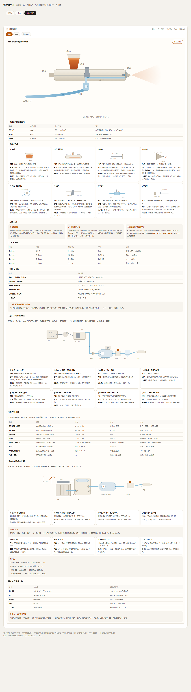
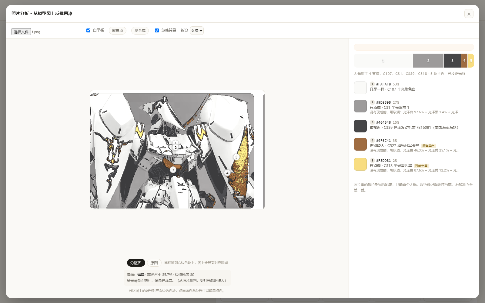

# 调色台 · 郡士 Mr. Color 调色计算

[](https://github.com/taninettty/gunze-paint-mixer/actions/workflows/test.yml)

给一个目标色，从**郡士（GSI Creos / Mr.Hobby）Mr. Color** 里算出该用哪几支、各几滴。

双击 `index.html` 就能用——不用装环境、不用联网（`spectral.js`、`gunze-data.js` 都在同目录）。



---

## 三步出配方

1. **目标色**：三种方式随你用
   - 输入郡士色号：`C39`、`39`、`dark yellow` 都认
   - 取色器 / 填十六进制
   - 展开「从图片取色」，在参考图上点一下（做模型最常用）
2. **手上的漆**：勾选你柜子里真有的那几支（最多 8 支），上面有搜索框。
   默认勾的是 C1–C7 七支基础色。
3. **配方**：占比、滴数、份数，外加预测色和 ΔE00。

右上角会显示**最接近的郡士色**——涂一个参考图取来的色，它直接告诉你"这大概是 C39"。

---

## 关于色库

`gunze-data.js` 里是 **226 支郡士 Mr. Color C 系列**，包含色号、中文名、英文名、近似屏幕色。界面上全部显示中文名，搜索框中英文和色号都能搜。

- 色号与英文名取自 [Scalemates 的 Mr. Color 色表](https://www.scalemates.com/colors/hobby-color--657/)，中文名按中文模型圈的通用叫法：C1–C50 取自[上上模型店的郡士漆表](https://blog.sina.cn/dpool/blog/s/blog_5aef5e870100jlnx.html)（如 C39「消光暗黄/沙漠黄」、C12「半光橄榄绿1」、C29「半光舰底红」），C51 以后沿用同一套命名规则（光泽/半光/消光 + 色名）；RLM71、FS34097 这类官方代号保持原样
- 共 **226 支**（198 实色、15 金属、10 透明、2 消光剂、1 珠光）

色值终究是屏幕近似值。你觉得哪支不对，直接改 `gunze-data.js` 里那条的 `hex` 就行，其它都不用动。

---

## 新手三步

页面顶部有一条引导（可关掉，记在浏览器里）：

1. 选目标色
2. 勾手上有的漆
3. 看配方，按毫升和滴数调

配方区底部还有「没有这些漆？看要买哪几支」——直接列最接近的三支，并说明各买一瓶 10ml 够用。

## 漆面诊断

喷涂知识 → 翻车急救 → 「拍照诊断」，拍一张喷坏的漆面，看大概是什么问题。

照片能判三类：

| 判据 | 说明 |
|---|---|
| 纵向硬边连续延伸 | 流挂（也可能是分模线/刻线，靠侧光确认） |
| 平坦区域里的孤立亮点/暗点 | 颗粒 / 灰尘 |
| 整片低彩度、高明度 | 白化 |

橘皮、干喷、渗漆从单张照片判不准，界面上直接说明，交给下面的八张症状卡。

每条结论都带「依据」和「怎么确认」——**不替你下结论，只给下一步该看哪儿**。

## 阴影 / 高光调法

配方区底部一排五个色卡，由当前目标色推出来：

| 卡 | 做法 | 用途 |
|---|---|---|
| 高光 | 明度 +13，彩度略降 | 受光面提亮 |
| 暖高光 | 明度 +12，b* 偏黄 | 暖色系模型 |
| 阴影 | 明度 −14，彩度不掉 | 通用阴影 |
| 冷阴影 | 明度 −15，b* 偏蓝紫 | 冷光环境 |
| 暖阴影 | 明度 −15，b* 偏棕红 | 暖光环境 |

每张卡直接给出用现有漆的配比，点一下设成目标色。

## 工序模板：五种

每一步的漆都可以**直接点开换**（下拉只列这一层该用的漆种），每层下面有一条专属小知识。

页面最下面。选好金属色和透明色，直接出清单：

**伪电镀**

| 步 | 漆 | 作用 | 层数 | 要点 |
|---|---|---|---|---|
| 1 | C2 光泽黑 | 底漆 | 2–3 层 | 喷到完全盖住、表面发亮 |
| 2 | C8 金属银 | 金属层 | 2 薄层 | 薄喷、间隔 10 分钟，厚喷会发暗 |
| 3 | C47 透明红 | 透明色 | 1–2 层 | 第一层雾喷，第二层湿喷 |

**糖果色**：底色 → 银色 → 透明色，银层越亮、透明层越薄，颜色越透。

**珠光色**

| 步 | 漆 | 作用 | 层数 |
|---|---|---|---|
| 1 | C1 光泽白（或目标色） | 底色 | 2 层 |
| 2 | C151 珍珠白 | 珠光层 | 2–3 薄层，薄而湿 |
| 3 | C46 光油 | 罩光 | 2 层 |

底色决定偏色：蓝底出蓝珍珠，白底出象牙珠光。珠光喷太干，片状粉立不起来会发灰。

**实色漆**：底漆 → 实色薄层 → 罩光。薄喷三层永远好过厚喷一层——厚喷会流挂、会盖掉细节。

**金属色**：底漆决定明度（黑底深、灰底浅），金属色薄喷多道出颗粒。

**关键不是配比，是层间干燥。** 黑底没干透、银层没干透就罩透明色，必花。

### 喷涂小知识（面板底部折叠着）

1. 薄喷三层好过厚喷一层，每层薄到能看见底色
2. 距离 15–20 厘米，匀速走枪，别停
3. 先喷边角再喷大面
4. 温度 < 15℃ 或湿度 > 75%，别喷光泽和透明
5. 金属漆、珠光漆会沉底，摇一分钟以上
6. 胶带先在手背粘一下再贴
7. 喷完立刻洗笔
8. 别近距离热风吹，会起橘皮
9. 橘皮 = 漆太稠或枪太远；灰尘 = 喷前地上洒水

## 透明漆怎么选

| 色号 | 名称 | 用途 |
|---|---|---|
| C46 | 光油 | 通用光泽保护层 |
| C47 | 透明红 | 尾灯、眼睛、伪电镀罩色 |
| C48 | 透明黄 | 车灯、金色调 |
| C49 | 透明橙 | 转向灯、复古暖调 |
| C50 | 透明蓝 | 玻璃、冷色调 |
| C138 | 透明绿 | 绿灯、仪表、科幻件 |
| C155 | 超透明光油 | 高光面罩光 |
| C181 | 半光光油 | 接近真车质感 |
| C182 | 消光光油 | 军模常用 |
| C183 | 透明灰调 | 压亮不压色 |

## 漆库分区

列表按漆种分组，一眼能分：

- **实色 · 珠光 199**（198 实色 + 1 珠光；珠光要和实色调，所以放一起）
- **金属漆 15**（单独一组）
- **透明漆 10**
- **消光剂 2**

搜索时中文、英文、色号都能用，分组会自动收起空组。

## 特殊漆：金属 / 透明 / 珠光 / 消光剂

| 类型 | 数量 | 例子 | 能不能进配方 |
|---|---|---|---|
| 实色 | 198 | 光泽白、半光橄榄绿 1 | ✅ |
| 金属 | 15 | 金属银 C8、枪金属 C28、金属红 C75 | ✅ 会提示 |
| 透明 | 10 | 透明红 C47、透明黄 C48、透明绿 C138 | ✅ 会提示 |
| 珠光 | 1 | 珍珠白 C151 | ✅ |
| 消光剂 | 2 | 消光剂 C30、粗颗粒消光剂 C188 | ❌ 只改光泽 |

金属和透明漆**可以选、可以算**——实际调色就是这么干的：银加金调香槟金、透明红加透明黄调透明橙，同族互混模型算得还行。

但跨族混的时候会同时给出物理提醒，不是拦着你，是让你知道结果会怎样：

- 金属 + 实色 → 金属粉被实色盖住，金属感明显减弱
- 透明 + 实色/金属 → 会发浑；**伪电镀、糖果色是分层喷出来的，不是混出来的**

消光剂单独处理：它只改光泽、不改颜色，所以不参与调色计算。

### 伪电镀怎么做

这不是一个配方，是一套工序：

1. **光泽黑打底**（C2 光泽黑），要亮、要平
2. **银色**（C8 金属银，更亮用 C211 铬银）
3. **透明色罩面**（C47 透明红 / C48 透明黄 / C50 透明蓝）

三层的膜厚和干燥时间比配比更关键——银层没干透就罩透明色，必然花。

## 每支漆的「调」

美术里不按"纯色相"分颜料，而是按**色相偏向**（colour bias）——绿没有纯绿，酞菁绿偏蓝，树汁绿偏黄。温莎牛顿就是这么标颜料的（[colour bias vs Munsell](https://eu.winsornewton.com/blogs/guides/colour-bias-versus-mansell-ratings)）。调色的时候也是这个思路：**加一点蓝，把绿往冷里推**，而不是算出一个精确配比。

所以配方里每支漆都带一个调子：

| 漆 | 调 | 说明 |
|---|---|---|
| White | 中性 | 彩度太低，不参与色相判断 |
| Brown | 橙 | 暗橙 |
| Yellow | 黄 | |
| Blue | 紫调蓝 | 偏紫的蓝 |
| Red | 红 | |

算法很直接：把漆的 Lab 色相角归到最近的色相族（红/橙/黄/绿/蓝/紫/品红），偏离超过 14° 就标成「X调Y」，彩度低于 12 算中性。

看配方时先看调子再看滴数：主料决定明度和彩度，那几滴微量决定**往哪个调上偏**。两边都加（比如同时加紫调蓝和红），说明这个色的色相卡在中间，靠两股相反的力顶出来。

---
## 主料按毫升，微调按滴

真实调法是两层：**100 ml 里 20 ml 红 + 80 ml 蓝，再额外加 2 滴黑**。

所以配方表长这样：

| 漆 | 占比 | 用量 |
|---|---|---|
| White | 79.2% | 80 ml |
| Brown | 9.9% | 10 ml |
| Yellow | 9.9% | 10 ml |
| Blue | 0.48% | 12 滴 |
| Red | 0.48% | 12 滴 |

- **主料**：1–3 支，按总量的 5% 步进（100 ml 就是 5 ml 一档）
- **微量**：最多 2 支，按滴算（1 滴 ≈ 0.04 ml），上限 12 滴

总量可选 20 / 50 / 100 / 200 ml。

搜索分两段：先只排主料，找出最像的六个组合；再对这几个组合分别试微量。不这么拆，「主料组合 × 微量组合」会直接爆掉。单次约 10–40 ms。

**一点实话**：微量那几滴往往有多个等价解。拿 20 红 + 80 蓝 + 2 滴黑 + 2 滴绿 这个例子去反推，主料 80/20 能准确还原，但微量给的是「9 滴黄」——在模型里 ΔE 0.13，看着一样。想做成一模一样，得知道你当时加的是哪几滴，照片和信息都不够。
## 算法

**混色**：Kubelka-Munk 单常数理论。

```
K/S = (1 - R)² / (2R)
(K/S)混合 = Σ cᵢ(K/S)ᵢ / Σ cᵢ
R = 1 + K/S - √((K/S)² + 2K/S)
```
所以 C5 青 + C4 黄会出绿，而不是像 RGB 混合那样出灰。

**反射率**：每支漆只存一个屏幕色，经 `spectral.js` 的 LHTSS 方法反推 380–750 nm 的反射率曲线。

**配方求解**：直接在 ΔE00 上搜索。对数坐标（softmax）参数化能同时兼顾 80% 的主色和 0.2% 的黑色；多起点坐标下降 + 成对转移精修；7 支漆一次求解约 6–20 ms。

**色差**：CIEDE2000，已用 Sharma 标准测试数据校验，10 组全部一致。

**配色失败时**：不是给一句"调不出来"，而是真算 8 遍"补哪支能救"，告诉你具体色号和能降到多少 ΔE。

---

## 精度边界

1. 每支漆的色值是**屏幕近似**，不是分光测色仪读数，也没做过实物标定。
2. 所以页面上的 **ΔE 0.02 不代表实物也 0.02**。它保证的是方向和比例合理。
3. 郡士漆是半透明硝基漆，**底色影响很大**：同样的配方，喷在灰补土上和喷在白补土上是两个颜色。深色件务必先打白底。
4. 稀释比例、喷涂厚度、光泽（消光/半消光/光泽）都会改变观感。
5. **结论：当配色计算器用，先在小样或流道上看一眼再上件。**


---

## 照片分析：从模型图上反推用漆

点左边的「📷 照片分析」，选一张模型照片。



它会做四件事：

1. **采样**：把图缩到 620 px，取大约 1.5 万个像素点。
2. **白平衡**：用照片四周边缘估一个背景色，把它当白参考拉成中性——室内暖光下这一步很关键。**背景不是白/灰时会自动关掉**，否则会把颜色带偏。
3. **拆色**：在 Lab 空间做 k-means，把画面拆成 4/6/8 块主色，按面积从大到小排。
4. **反推**：每块主色给出「最接近的郡士色号 + ΔE」和「用你勾选的漆怎么配 + ΔE」。点任意一块就把它设成目标色，回到主界面看完整配方。

也可以直接在照片上点某个零件取单点色，适合面积很小、被 k-means 并进大块里的细节。

分析完图上显示的是**分区图**：每个像素按它所属的色块上色，并用 ①②③④ 标出位置——**编号和右边列表一一对应**。这就是"哪块是哪块"的答案。

鼠标移到右边任意一块上，图上只留下那一块、其余变灰，可以确认它到底是哪个零件。

「占比」按**模型本身**归一（背景已经扣掉），几块加起来是 100%。
下面「原图 / 分区图」可以随时切换。
**「忽略背景」**默认开着：和边缘背景色 ΔE 小于 9 的色块会被丢掉。如果你的模型本身是白色系而背景也是白的，把它关掉。


### 阴影不会把颜色拆散

这是最关键的一步。同一个漆在亮面和暗面上是两个颜色，普通聚类会把它拆成两块、给出两个色号。

现在的做法：

1. **聚类时压低明度权重**（×0.35）——先按色相分家，明暗不参与分家
2. **按色相合并**——色相差 12° 以内的块并回一块
3. **代表色取受光面**——取这块里明度 70 分位附近那批像素平均，阴影不参与
4. **记录明度跨度**——列表里显示「明度 27–51」，跨度越大说明阴影越重

拿一个带渐变的红色躯干测试：亮面 #C82828（L 44）、暗面 #781919（L 26），会合并成一块，代表色 #C82828，明度跨度 26–44。

中性色（白灰黑）不参与合并，否则会糊成一团。

### 可以手动改漆种

自动判定给的是参考，你可以直接改。点任意色块 → 标记卡里出现四个按钮：

**实色 / 金属 / 珠光 / 透明**

选了金属，两件事跟着变：

1. **只从 15 支金属漆里挑最近的**，不会推荐一支实色
2. **给出金属叫法**——按色相和明度算：

| 颜色 | 判定 |
|---|---|
| #F8DD81 浅金 | 香槟金 |
| #C9A227 金 | 黄金色 |
| #A76938 棕金 | 古铜色 |
| #8A8A8E 银灰 | 枪铁色 |
| #2A3A6A 深蓝 | 蓝钢色 |

规则不复杂：彩度低于 12 按明度分银 / 枪铁 / 黑铁；有彩度就看色相，黄橙系按明度分香槟金 / 黄金 / 古铜，蓝紫系叫蓝钢。

### 漆面感：单张图只能给线索

一块漆面上，亮部和暗部的**色相会不会变**，是实色和金属/珠光的分界：

| 情况 | Δ色相 | 彩度比 | 判定 |
|---|---|---|---|
| 纯明暗（实色） | 0.1° | 1.19 | 实色 |
| 亮部偏橙（金属） | 4.9° | 1.11 | 实色（太弱，测不出） |
| 暗紫→亮金（珠光） | 16–33° | 0.7–1.3 | 随角异色 |

这个判定**只是线索**：色相差 5° 以内基本是噪声，真正的金属漆在照片里也只偏几度。

### 光泽粗判

分析时会顺带量两个数：**高光占比**（比周围明显亮、且几乎没彩度的像素比例）和**边缘锐度**（这些像素周围的亮度梯度）。

- 占比 < 0.4% → 消光 / 哑光
- < 2%，或边缘发糊 → 半消光
- 又亮又锐 → 光泽

这是从照片粗判，受打光影响极大：正面柔光会抹掉高光，侧逆光会凭空造出高光。它只够回答"最后要不要加消光剂"，不够判断具体型号。
### 这一步能做到什么、不能做到什么

能：告诉你这张图上**大概用了哪几支郡士漆**、主色比例是多少、你手上这些漆能不能凑出来。

不能：

- **照片里没有配方**。它只能反推"看起来是什么颜色"，不知道原作者用了什么漆、喷了几层、有没有做旧。
- 光照、阴影、白平衡误差会直接改成结论。同一张图开不开白平衡，色号可能差两三个。
- 消光/光泽会显著改变观感，照片上分不出来。
- 金属漆、珍珠漆、透明漆已经在色库里剔除了，这些质感**匹配不了**，只会被当成普通的近似色。
- 水贴、渗线、旧化、灰尘都会污染色块。
- 阴影面会比实际漆色暗一大截——**优先看受光均匀的平面区域**，不要点阴影。

建议拍法：均匀白光、不要闪光灯直打、避免强烈高光、背景用白纸或灰卡。
---

## 颜色抽不准？先修光源

照片里的颜色 = 漆的颜色 × 光。不把光剥掉，抽出来的永远是"照片色"。

现在做了四件事：

### 1. 灰色阴影法估光源（自动）

不再用画面四边猜背景，改成 [Shades-of-Gray](https://www.sciencedirect.com/science/article/abs/pii/S1077314203001741)（Finlayson & Trezzi, 2004）：对每个通道取 p 次幂平均（这里 p=6），得到光源色，再按通道补偿。

> 实测：暖光下的白纸（232,214,190）→ 补偿后中性灰 #D5D5D5，彩度从 14.3 降到 0.0。

p=6 而不是 p=1（经典灰世界），是因为模型照片里大面积是白/灰背景，p 大一点更偏向"最亮的那个面"，不容易被暗部带偏。

### 2. 手动白点（最准）

画面上放一张白纸、灰卡，或直接点在白色零件上，点「取白点」再点一下画面——用这一点的颜色反推光源。**有白点在画面里时，这一步永远比自动估得准。**

### 3. 只采平坦区域

采样时算局部梯度，只收梯度小的像素。边缘、颗粒、高光边界这些地方的颜色是混出来的，收进去就污染结果。

### 4. 背景参考也走同一套白平衡

之前一个真 bug：白平衡只修正了模型像素，背景参考还是原始色，两边对不上，"忽略背景"直接失效（背景占 91% 都剔不掉）。现在两边用同一个增益。

---

## 还修不了什么

- **混合光源**（窗户自然光 + 室内灯）：一张图里有两个光源，全局白平衡只能折中
- **镜面高光**：光滑面上那层白是反射光，不是漆色，只能靠梯度过滤挡掉一部分
- **相机内处理**：手机直出的 JPEG 已经做过锐化、降噪、色彩增强，信息不可逆
- **深色漆**：黑色、深蓝这种本来就暗，稍微一点杂光误差就很大

想再进一步，只有两条路：拍 RAW / 用手动白平衡，或者画面里带一张标准色卡（ColorChecker）做 3×3 色彩校正矩阵。后者是工业界的做法，代价是每次拍照都要带卡。

---

## 配比按 5% 步进

配方直接给 5% 的整数倍，不出 2:8 / 3:7 这种粗比例：

```
C1 80% (16 滴) + C7 10% (2 滴) + C4 10% (2 滴)      ΔE 3.7
```

这不是把精确解四舍五入——那样会漏掉更优的组合。程序在 5% 网格上，把 4 支以内、加起来 100% 的所有组合枚举一遍，取真正最优的那个（20 个单位分给 4 支，1771 种，约 3 ms）。

表格上方那行「精确解 ΔE 0.0」是理论下限，通常靠 0.1% 级的微量堆出来——换成 20 滴只有 0.05 滴，量不出来。**以 5% 配方的 ΔE 为准。**

参考标尺：

- ≤ 2：基本能骗过眼睛
- 3–5：看得出，但能接受
- > 5：这个色用现有漆 + 5% 精度做不出来

顺带一个实测结论：C39 这个色，即使把范围放宽到全部 7 支基础色、5% 网格，最优也只有 80/10/10 的 ΔE 3.71。不是算法没找到，是它真的到不了。

---
## 分层反推：喷法里唯一能算的那部分

同一个颜色，可能是"深色漆喷厚了"，也可能是"浅色漆喷薄了盖在深底上"。只看颜色分不出来——但**底漆已知**时就能反推。

主界面「配方」下方可以选底漆，五种标准底色：**白 / 浅灰 / 黑 / 粉 / 棕**。粉底常用于肤色和暖色系，棕底常用于军模的锈红底。程序按 Kubelka-Munk 有限厚度公式：

```
R = [1 − Rg(a − b·coth(bX))] / [a − Rg + b·coth(bX)]
a = 1 + K/S,   b = √(a² − 1)
```

对全部 226 支漆 × 不同厚度做搜索，给出最像的 3 支和对应的遮盖程度。

示例（底漆浅灰，目标取 C39 满涂色）：

| 候选 | ΔE | 遮盖 |
|---|---|---|
| C39 Dark Yellow | 0.0 | 已经盖死（层数分不出来） |
| C321 Light Brown | 1.7 | 薄喷 |
| C527 Khaki | 2.7 | 很薄，会透底 |

实测反推能力：把 C39 喷在浅灰上（X=1）的观感喂进去，能还原出 C39（ΔE 0.08）；喷在黑底上薄薄一层（X=0.5），也能还原（ΔE 0.39）。

**边界**：底漆选错，结论就错。这是"假设推假设"，不是测量。它的真实用途是消歧义——当你拍到一个偏暗的色，它能告诉你"这更像 C39 喷薄了，而不是换了一支 C44"。

另外，漆膜一旦盖死，厚度在数学上就不可辨了（不同厚度给出同一个颜色），这时会明确写「层数分不出来」，不硬编一个数。

---
## 文件

| 文件 | 作用 |
|---|---|
| `index.html` | 界面 |
| `app.js` | 交互逻辑 |
| `engine.js` | 混色与配方求解内核（不依赖 DOM） |
| `gunze-data.js` | 郡士 226 支色库 |
| `spectral.js` | 光谱数据与色度转换（MIT，© Ronald van Wijnen） |
| `test.js` | 自测 |
| `preview.png` | 界面截图 |

---

## 自测

```bash
node test.js
```

91 项：ΔE00 标准数据、色库完整性（金属漆/清漆是否真的剔干净、色号是否重复）、12 支单支自洽、C5+C4 是否出绿、7 组常见郡士色用基础 7 支能否还原、最近色号、照片分析的拆色与白平衡、分层反推的往返还原、光泽判定、边界情况、页面元素一致性、性能。

---

## 已知局限

- **只覆盖 C 系列（油性硝基）**。水性 H 系列色号不同，颜色接近但不完全一样，配方要重新试。
- 没有 C8–C10 金属漆，所以调不出金属色。
- 跨品牌（田宫、盖亚、匠域）不通用，各家的色浆强度和色相都不一样。
- 单一漆的"着色力"差异没有建模——真实情况是 C1 白很弱、C2 黑极强，模型里这一点由 K/S 曲线的量级自动体现，但批次差异仍未覆盖。

## 代码约定

- **浏览器端只用 ES5**（var + IIFE + 无构建），保证双击 index.html 就能跑
- **test.js 可以用现代语法**，它只在 Node 里跑
- 所有阈值集中在 `engine.js` 顶部的 `TUNING` 对象，改手感不用满文件找
- 提交前跑 `node test.js`，CI 也会跑

## 许可

MIT。光谱数据来自 [spectral.js](https://github.com/rvanwijnen/spectral.js)（MIT），漆色数据整理自郡士公开色表，仅供调色参考。
